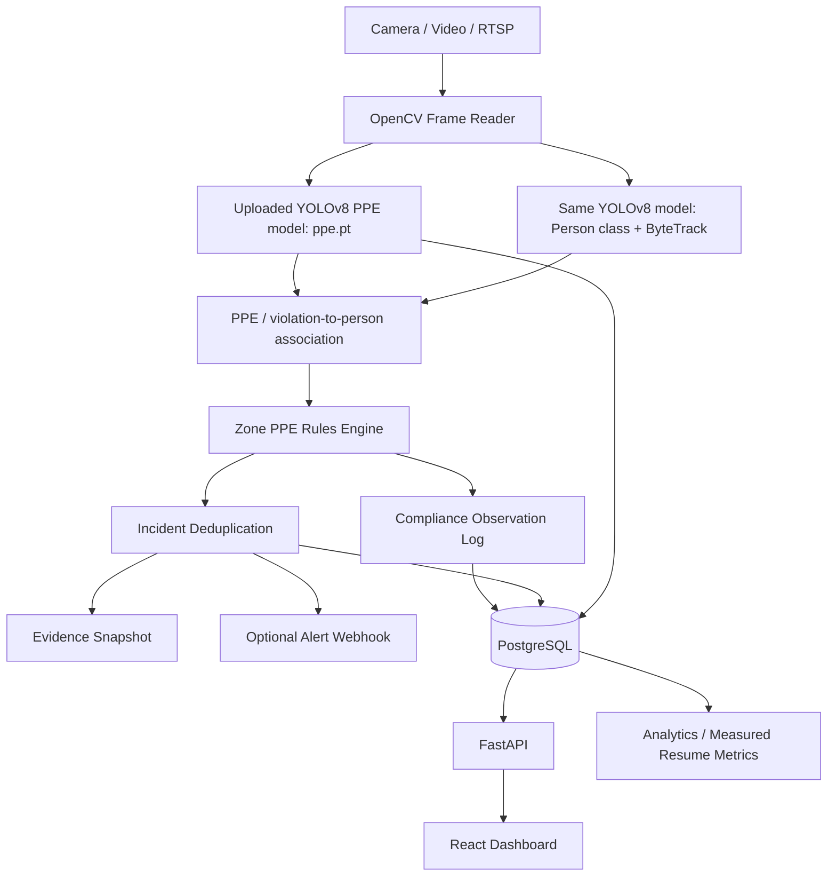

# SafeVision AI Architecture

This repository is an upgrade of the uploaded SafeVision AI webcam PPE detector, not a replacement project.

## What came from the original project

The uploaded project already supplied:

- a trained `ppe.pt` YOLO model,
- webcam capture through OpenCV,
- real-time YOLO inference,
- bounding-box visualization,
- a manual 25-class list that includes `Person`, `Hardhat`, `Safety Vest`, `Gloves`, `Mask`, `NO-Hardhat`, `NO-Mask`, and `NO-Safety Vest`,
- a stationary-image YOLO example.

The upgraded project keeps that model at `ml/weights/ppe.pt` and preserves the old scripts under `legacy/original_project/`.

## Why the same model is used for tracking

The original model already includes a `Person` class, so the upgraded pipeline does not need to download a separate COCO model by default. `PersonTracker` loads the same `ppe.pt`, finds the person class ID dynamically, and calls Ultralytics tracking with `tracker="bytetrack.yaml"` and `persist=True`.

This yields a stable `track_id` that can be used to suppress repeated incidents for the same worker/violation.

## Why explicit negative classes matter

The original model contains explicit violation labels such as `NO-Hardhat` and `NO-Safety Vest`. The upgraded rules engine prefers those signals over assuming that "no positive hardhat box" automatically means "worker has no hardhat".

That distinction reduces false incident creation caused by a normal detector miss.

The legacy code checks `NO-Gloves`, but that label is not present in its class list. For that reason, absence-based glove inference is disabled by default and can be opted into with `ABSENCE_BASED_PPE=gloves` only after you validate it on your footage.
