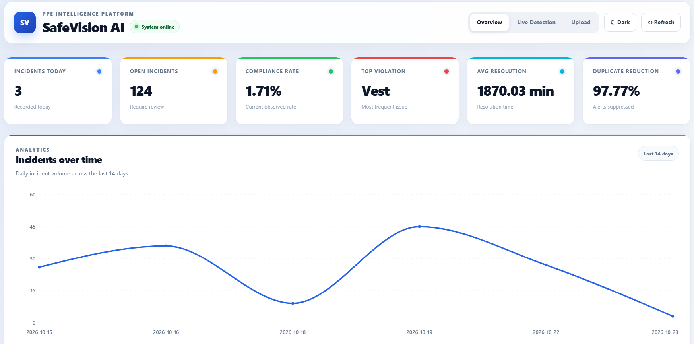
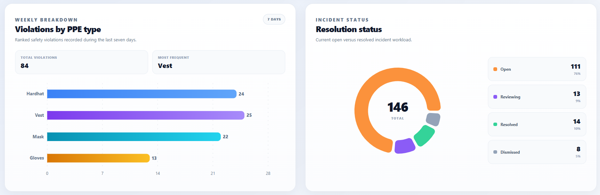
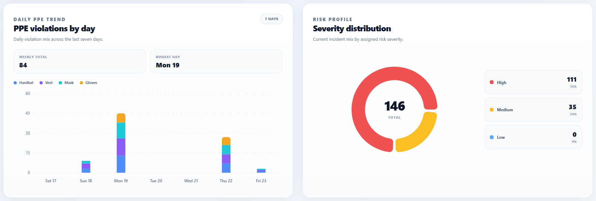
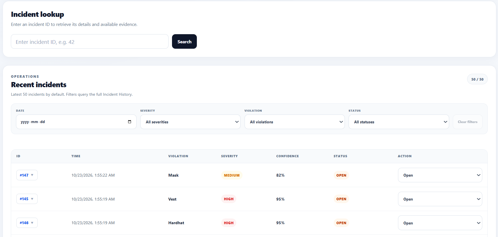
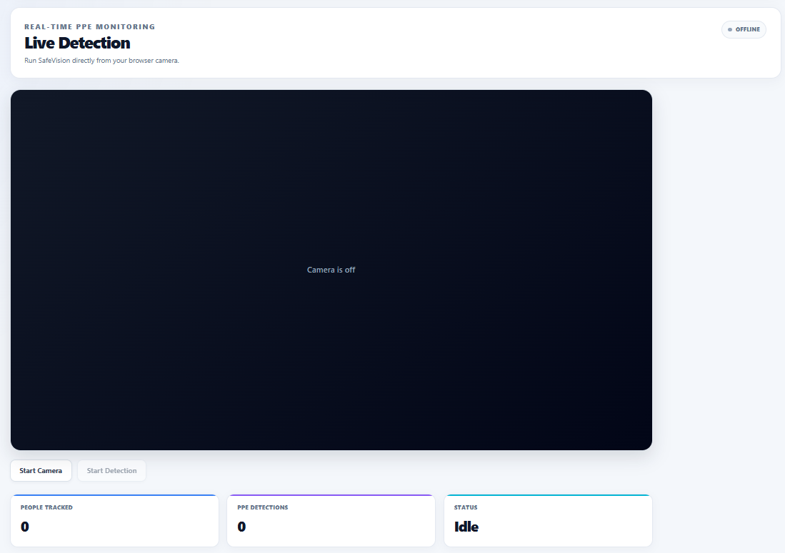
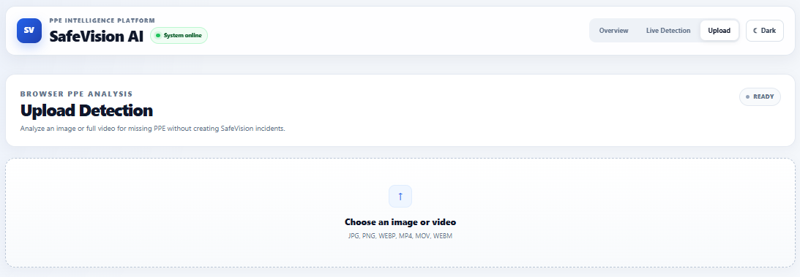
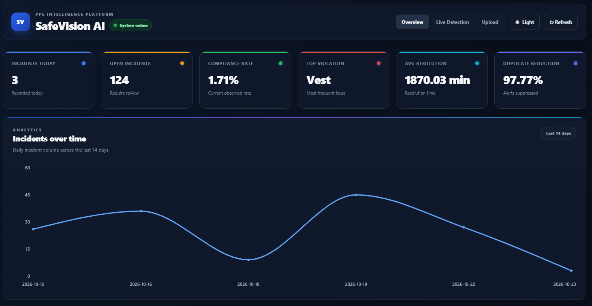

# SafeVision AI — PPE Intelligence Platform

SafeVision AI is a full-stack computer vision platform for detecting personal protective equipment (PPE) violations, reviewing incidents, and visualizing workplace safety trends.

The application performs PPE inference directly in the browser using an ONNX model, provides live webcam monitoring and uploaded image/video analysis, and uses a FastAPI/PostgreSQL backend for incident management, evidence storage, analytics, and operational reporting.

> **Portfolio project:** SafeVision AI demonstrates an end-to-end computer vision system, including model inference, browser-side tracking, event confirmation, REST APIs, database persistence, analytics, evidence handling, responsive UI design, and cloud deployment.

## Live Demo

**Frontend:** https://safevision-ai-ppe.netlify.app  

> 🔴 **IMPORTANT: AFTER USING LIVE DETECTION, PLEASE CLICK THE RED `CLEAR DATA` BUTTON TO REMOVE ALL INCIDENTS RECORDED DURING YOUR SESSION.**

The production frontend is deployed on Netlify, with a FastAPI backend and PostgreSQL database supporting incident storage, analytics, and evidence management.

---

## Screenshots

### Dashboard Overview



The main dashboard summarizes current incident activity, compliance metrics, resolution performance, duplicate suppression, and the recent incident trend.

### PPE Analytics and Incident Status



Seven-day PPE analytics show violation frequency by PPE type alongside the current incident workflow distribution.

### Daily PPE Trend and Severity Distribution



The dashboard includes daily PPE trends and a risk-oriented severity breakdown.

### Incident Lookup and Recent Incidents



Incident records can be searched by ID, filtered across the full incident history, updated through the operational workflow, and expanded to view available evidence.

### Live Browser Detection



Live Detection uses the browser camera, browser-side inference, lightweight person tracking, violation confirmation, and incident creation.

### Upload Detection



Upload Detection analyzes images or full videos locally in the browser without creating dashboard incidents.

### Dark Mode



The interface supports a responsive dark theme across the dashboard and detection pages.

---

## Key Features

- **Browser-based PPE inference** using ONNX Runtime Web.
- **Live webcam monitoring** with real-time detection overlays.
- **Image and video analysis** without uploading the source media to the backend.
- **Browser-side person tracking** for stable worker IDs across frames.
- **Violation confirmation logic** to reduce one-frame false alerts.
- **Duplicate suppression** using frontend latching/cooldowns and backend incident cooldown checks.
- **Incident evidence capture** from confirmed live violations.
- **PostgreSQL-backed incident history** with retained evidence images.
- **Incident workflow states:** Open, Reviewing, Resolved, and Dismissed.
- **Historical filtering** by date, PPE violation, severity, and status.
- **Incident lookup** by database ID.
- **Dashboard analytics** for trends, PPE breakdowns, severity, status, compliance, and duplicate reduction.
- **Light and dark themes** with responsive layouts.
- **Model evaluation utilities** for precision, recall, F1, mAP, latency, and FPS reporting.

---

## PPE Detection

The browser PPE model supports explicit object-detection classes for workers and PPE, including trained negative classes such as:

- `NO-Hardhat`
- `NO-Mask`
- `NO-Safety Vest`

Positive classes include:

- `Hardhat`
- `Mask`
- `Safety Vest`
- `Gloves`
- `Person`

### Missing Gloves

The original PPE model does **not** contain a trained `NO-Gloves` class.

SafeVision therefore treats missing-gloves detection differently. A conservative browser-side inference layer uses hand landmarks, the model's existing positive `Gloves` detection, worker association, and exposed-skin evidence to infer a possible visible bare-hand violation.

Missing-gloves results are presented as **inferred**, not as YOLO confidence values.

---

## System Architecture

```text
┌─────────────────────────────────────────────────────────────┐
│                         Browser                             │
│                                                             │
│  React + TypeScript + Vite                                  │
│                                                             │
│  ┌───────────────────────┐   ┌───────────────────────────┐  │
│  │ PPE ONNX Inference    │   │ Hand / Glove Inference   │  │
│  │ ONNX Runtime Web      │   │ MediaPipe                │  │
│  └───────────┬───────────┘   └─────────────┬─────────────┘  │
│              │                             │                │
│              └──────────┬──────────────────┘                │
│                         ▼                                   │
│             Browser-side tracking + rules                  │
│                         │                                   │
│            Confirmed live violation only                   │
└─────────────────────────┬───────────────────────────────────┘
                          │ JSON + evidence JPEG
                          ▼
┌─────────────────────────────────────────────────────────────┐
│                     FastAPI Backend                         │
│                                                             │
│  Incident API • Deduplication • Analytics • Cameras        │
│  Evidence retrieval • Status updates • Model metrics       │
└─────────────────────────┬───────────────────────────────────┘
                          │
                          ▼
┌─────────────────────────────────────────────────────────────┐
│                    PostgreSQL / Neon                        │
│                                                             │
│  Incidents • Evidence • Cameras • Sites • Analytics data   │
│  Model evaluation records                                  │
└─────────────────────────────────────────────────────────────┘
```

### Why inference runs in the browser

The production backend is intentionally lightweight. Heavy YOLO/PyTorch/OpenCV inference is not required on the Render server.

This design:

- reduces backend memory requirements,
- avoids sending every camera frame to the server,
- keeps upload analysis local to the user's browser,
- lets the backend focus on persistence and analytics,
- and makes the deployed architecture practical on lightweight cloud infrastructure.

---

## Technology Stack

### Frontend

- React
- TypeScript
- Vite
- Recharts
- ONNX Runtime Web
- MediaPipe Tasks Vision
- HTML Canvas API
- Browser MediaDevices API

### Backend

- Python
- FastAPI
- SQLAlchemy
- Pydantic
- Alembic
- PostgreSQL
- Psycopg
- Uvicorn

### Machine Learning

- YOLO / Ultralytics for original training and offline evaluation
- ONNX model for production browser inference
- MediaPipe hand landmarks for conservative missing-gloves inference

### Deployment

- **Netlify** — React frontend
- **Render** — FastAPI API
- **Neon** — PostgreSQL database

---

## Repository Structure

```text
SafeVision-AI-PPE/
├── backend/
│   ├── app/
│   │   ├── api/
│   │   ├── core/
│   │   ├── db/
│   │   ├── schemas/
│   │   └── services/
│   ├── alembic/
│   ├── scripts/
│   ├── tests/
│   ├── requirements.txt
│   └── .env.example
│
├── frontend/
│   ├── public/
│   │   ├── models/
│   │   │   └── ppe.onnx
│   │   └── ort/
│   │       └── ort-wasm-simd-threaded.wasm
│   ├── src/
│   │   ├── pages/
│   │   ├── services/
│   │   ├── App.tsx
│   │   ├── IncidentLookup.tsx
│   │   ├── api.ts
│   │   ├── main.tsx
│   │   ├── styles.css
│   │   └── types.ts
│   └── package.json
│
├── ml/
│   ├── evaluation/
│   └── weights/
│
├── docs/
│   └── images/
│
├── docker-compose.yml
├── netlify.toml
├── ARCHITECTURE.md
└── README.md
```

---

## Local Development

### Prerequisites

Install:

- Python 3.12+
- Node.js / npm
- PostgreSQL or Docker
- Git

---

## 1. Clone the Repository

```bash
git clone <your-repository-url>
cd SafeVision-AI-PPE
```

---

## 2. Configure the Backend

Create a backend environment file:

```text
backend/.env
```

Example for a local PostgreSQL database:

```env
DATABASE_URL=postgresql+psycopg://Password@localhost:5432/safevision
FRONTEND_ORIGIN=http://localhost:5173
EVIDENCE_RETENTION_COUNT=100
INCIDENT_COOLDOWN_SECONDS=30
```

Do not commit real database passwords or production connection strings.

### Create and activate the virtual environment

Windows PowerShell:

```powershell
cd backend
python -m venv .venv
.\.venv\Scripts\Activate.ps1
pip install -r requirements.txt
```

### Run database migrations

```powershell
alembic upgrade head
```

### Start FastAPI

```powershell
uvicorn app.main:app --reload
```

The local backend will be available at:

```text
http://127.0.0.1:8000
```

---

## 3. Configure the Frontend

Create:

```text
frontend/.env
```

with:

```env
VITE_API_URL=http://127.0.0.1:8000/api
```

Install dependencies and start Vite:

```bash
cd frontend
npm install
npm run dev
```

The frontend will normally be available at:

```text
http://localhost:5173
```

---

## Optional Local PostgreSQL with Docker

From the project root:

```bash
docker compose up -d
docker compose ps
```

The database configured in `backend/.env` determines which database the local backend uses.

Running the frontend on localhost does **not** automatically mean the application is using a local database.

---

## Browser Model Assets

Production PPE inference requires these frontend assets:

```text
frontend/public/models/ppe.onnx
frontend/public/ort/ort-wasm-simd-threaded.wasm
```

These files are loaded directly by the browser.

The ONNX model input is `640 × 640`, and inference is performed with ONNX Runtime Web.

---

## Live Detection Flow

```text
Camera frame
    ↓
Browser ONNX PPE inference
    ↓
Missing-gloves inference enhancement
    ↓
Person tracking
    ↓
Violation-to-person association
    ↓
Multi-frame confirmation
    ↓
Frontend cooldown / spatial duplicate suppression
    ↓
Evidence snapshot
    ↓
POST /api/browser-incidents
    ↓
Backend duplicate check
    ↓
PostgreSQL incident + evidence
```

Only confirmed live violations are submitted to the backend.

---

## Upload Detection Flow

Uploaded images and videos are analyzed locally in the browser.

### Images

1. Load image in the browser.
2. Run PPE ONNX inference.
3. Run optional missing-gloves inference.
4. Associate violations with detected workers.
5. Draw violating workers and PPE faults.
6. Display the analysis result.

### Videos

1. Load the full video locally.
2. Sample frames at intervals.
3. Run browser PPE inference.
4. Track workers across sampled frames.
5. Merge repeated detections into continuous violation events.
6. Produce a timestamped violation timeline.

Upload analysis does **not** create incidents or modify dashboard analytics.

---

## Incident Management

Live detections can create incident records containing:

- camera ID,
- worker track ID,
- violation type,
- missing PPE,
- severity,
- confidence when applicable,
- detection timestamp,
- workflow status,
- resolution timestamp,
- and retained evidence.

Supported workflow states:

```text
Open
Reviewing
Resolved
Dismissed
```

The dashboard shows the newest 50 incidents by default. Activating historical filters queries the stored PostgreSQL incident history with pagination.

---

## Evidence Retention

Confirmed live incidents can include an annotated JPEG evidence snapshot.

Evidence bytes are stored in PostgreSQL and retrieved through the incident API.

The application retains only the latest configured evidence records to control database storage. The current default retention target is 100 evidence images.

Older incident metadata can remain available even when its evidence image has been pruned.

---

## API Overview

Common endpoints include:

```text
GET    /api/health

GET    /api/incidents
GET    /api/incidents/count
GET    /api/incidents/{id}
GET    /api/incidents/{id}/evidence
POST   /api/incidents
PATCH  /api/incidents/{id}

POST   /api/browser-incidents

GET    /api/analytics/summary
GET    /api/analytics/trends
GET    /api/analytics/dashboard-charts

GET    /api/cameras
POST   /api/cameras
PATCH  /api/cameras/{id}

GET    /api/model/performance
```

FastAPI also provides interactive API documentation when running locally:

```text
http://127.0.0.1:8000/docs
```

---

## Analytics

The dashboard includes:

- incidents recorded today,
- open/reviewing workload,
- observed compliance rate,
- most common violation,
- average resolution time,
- duplicate reduction,
- 14-day incident trend,
- seven-day PPE violation breakdown,
- daily PPE violation mix,
- incident status distribution,
- severity distribution,
- full-history incident filtering,
- incident evidence inspection.

Severity is assigned independently from model confidence.

Current PPE severity policy:

| Missing PPE | Severity |
|---|---|
| Hardhat | High |
| Safety Vest | High |
| Mask | Medium |
| Gloves | Medium |

---

## Model Evaluation

The repository includes offline utilities for inspecting and evaluating the original YOLO model.

Example:

```bash
python evaluate_yolo.py \
  --weights ml/weights/ppe.pt \
  --data path/to/data.yaml \
  --out ml/evaluation/results/latest.json
```

Evaluation output can include:

- precision,
- recall,
- F1 score,
- mAP50,
- mAP50-95,
- inference latency,
- FPS.

Model metrics can then be imported into PostgreSQL for dashboard or portfolio reporting.

---

## Testing

Backend tests use SQLite in memory where possible so unit/API tests do not require a running PostgreSQL instance.

Example:

```bash
cd backend
pytest
```

Tests include coverage for backend health checks, incident deduplication, and PPE rule behavior.

---

## Production Configuration

### Frontend

```env
VITE_API_URL=https://safevision-ai-ppe.onrender.com/api
```

### Backend

Production secrets such as `DATABASE_URL` should be configured through the hosting provider's environment settings rather than committed to Git.

The Render backend connects to PostgreSQL using its production `DATABASE_URL`.

---

## Design Notes

### Duplicate Reduction

SafeVision uses multiple layers of duplicate suppression:

1. browser worker tracking,
2. multi-frame violation confirmation,
3. incident latching,
4. time-based frontend cooldowns,
5. spatial recent-region suppression,
6. backend cooldown checks.

This helps prevent the same continuously visible PPE fault from producing an incident on every processed frame.

### Privacy-Oriented Upload Analysis

Image and uploaded-video inference runs in the browser. The source media does not need to be sent to the FastAPI server for PPE detection.

### Lightweight Production Backend

The production backend does not require PyTorch, Ultralytics, OpenCV, or NumPy for normal deployed inference.

This keeps the backend focused on API and data workloads.

---

## Limitations

SafeVision AI is a portfolio and research-oriented safety monitoring project, not a certified workplace safety system.

Detection quality can be affected by:

- lighting,
- camera angle,
- occlusion,
- worker distance,
- PPE appearance,
- motion blur,
- model training coverage,
- hand visibility.

AI detections should support human review rather than replace workplace safety procedures or professional judgment.

---

## Future Improvements

Possible extensions include:

- camera-specific configuration,
- multi-site administration,
- authentication and role-based access,
- notification integrations,
- configurable PPE policies by zone,
- richer model monitoring,
- improved worker re-identification,
- production-scale evidence object storage,
- additional PPE classes,
- dedicated training data for negative glove detection.

---

## Project Goal

SafeVision AI was built to demonstrate how a computer vision model can be developed into a complete operational application rather than remaining only as an inference script.

The project combines:

**Computer Vision + Browser ML + Backend APIs + PostgreSQL + Analytics + Cloud Deployment + Product UI**

into one end-to-end PPE intelligence platform.
